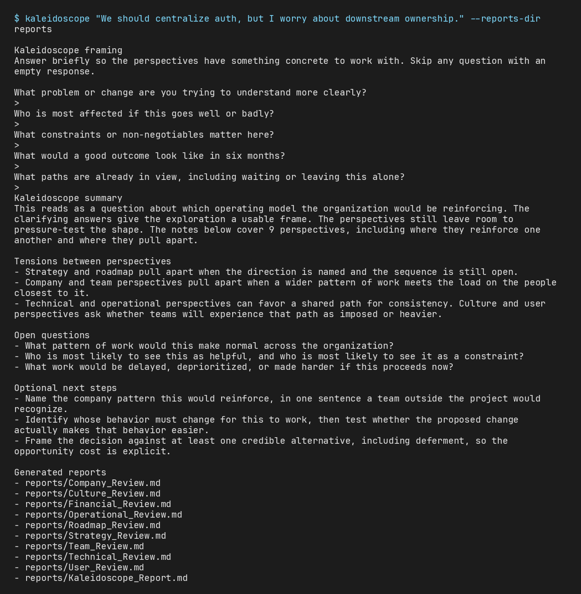

# Kaleidoscope

[](https://github.com/fairley46/kaleidoscope/actions/workflows/ci.yml)

Kaleidoscope explores a problem from multiple perspectives and writes the notes to disk.



## What it does

You start with a rough problem statement. Kaleidoscope asks a short set of clarifying questions, then reads the problem through nine perspectives: Company, Team, Culture, Strategy, Roadmap, Technical, Operational, Financial, and User. It writes one note per perspective and a master report under `reports/`.

The master report leads with an exploration overview. Then it lists each perspective, where those perspectives reinforce each other, tensions between them, and open questions. Optional next steps sit in a later section.

## Local files

Kaleidoscope writes markdown on your machine. You can edit the files and reread them before you share them.

V1 analysis is `HeuristicAnalysisProvider` in `providers.py`. That class uses the Python standard library only. `cli.py` constructs it. Another provider can implement `AnalysisProvider`.

## Quickstart

You need Python 3.9 or newer.

```bash
git clone https://github.com/fairley46/kaleidoscope.git
cd kaleidoscope
python3 -m venv .venv
source .venv/bin/activate
pip install -e .
```

Run a rough prompt. Type the answers at the prompts, or pipe them on stdin:

```bash
kaleidoscope "We should centralize this platform capability, but I am worried about downstream effects."
```

Without installing the console script:

```bash
PYTHONPATH=src python3 -m kaleidoscope "This migration seems technically right but organizationally risky."
```

Each run writes one `*_Review.md` per lens and `reports/Kaleidoscope_Report.md`. Git ignores generated files in `reports/`.

## Lenses

The default lenses are Company, Team, Culture, Strategy, Roadmap, Technical, Operational, Financial, and User.

Copy `templates/Lens_Template.md` into `lenses/` and run Kaleidoscope again. The loader reads every `.md` file in that directory.

## Layout

```text
kaleidoscope/
  lenses/                 # editable markdown lens definitions
  templates/              # Lens_Template.md for custom lenses
  reports/                # generated reviews, gitignored
  src/kaleidoscope/
    cli.py                # argparse entry
    question_flow.py      # clarifying questions
    lens_loader.py        # markdown lens parser
    providers.py          # AnalysisProvider and HeuristicAnalysisProvider
    analyzer.py           # per-lens analysis
    synthesizer.py        # cross-lens synthesis
    report_writer.py      # markdown report output
  tests/                  # unittest smoke tests
```

## Status

This is a V1 prototype. `HeuristicAnalysisProvider` does not call a model. There is no web interface, authentication, or shared editing.

## License

MIT. See [LICENSE](LICENSE).
